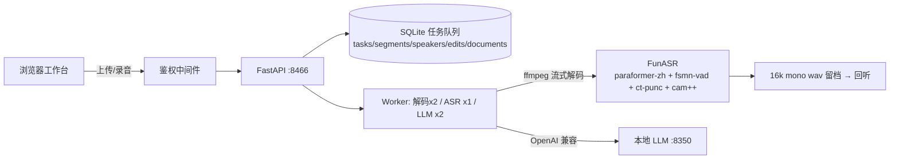

# 语音转写工作台 · ASR-Web

FunASR Paraformer 中文会议转写 + LLM 校对/整理的本地 Web 工作台（MVP）。

上传会议录音 → 识别并区分说话人 → 人工校正"谁说了什么" → LLM 分阶段整理（忠实校对 → 会议理解 → 会议纪要/汇报材料）→ 随时回听原始录音核对。

**全部本地处理**：ASR 与 LLM 均跑在自己的 GPU 服务器上，录音与会议材料不出内网。

## 功能（Meeting Workbench MVP）

- **任务化**：录音/文件上传异步转写，SQLite 持久化；服务重启自动恢复（中断任务标记可重试、排队任务续跑）；取消/重试/删除（含文件清理）；重复提交自动去重
- **多人会议**：CAM++ 说话人聚类自动分组；说话人改名/合并/拆分/逐段改派；未知说话人显式标注；ASR 原始结果不可变（人工/LLM 修正分层存储，带编辑历史）
- **原音联动**：录音保留在服务端（16k mono wav），点击任意片段/理解条目的 `#segment` 引用直接回听对应音频（HTTP Range 支持拖动）
- **LLM 三阶段**（不做一次性黑盒总结）：
  1. **忠实校对**——分批逐段纠 ASR 错误（同音字/专名/幻觉/标点），漏段自动重试，片段级回填，缺段如实上报
  2. **会议理解**——主题/讨论/观点/分歧/决定/建议/待办/待确认，严格区分"建议≠通过"，全部条目带 `segment_ids` 溯源，非法引用过滤并计数
  3. **正式材料**——完整文字稿/主题大纲/会议纪要/情况汇报四种，可配标题/受众/字数/语气/是否保留发言人/是否附待确认；截断自动续写并在仍截断时标注
- **导出**：TXT / SRT（含说话人与时间）/ Markdown
- **安全**：Token 鉴权（cookie / Bearer / `?token=`），未配置时启动自动生成并落盘 `data/.auth-token`(0600)；上传流式限长、解码时长上限、ffmpeg 超时与并发限制、GPU 上 ASR 串行

## 架构



## 快速部署

### 1. 环境

```bash
python3 -m venv /data/tools/funasr-env
/data/tools/funasr-env/bin/pip install torch torchaudio numpy==1.26.4 \
    funasr modelscope fastapi "uvicorn[standard]" python-multipart imageio-ffmpeg
```

> imageio-ffmpeg 自带静态 ffmpeg 二进制，服务器无需 `apt install ffmpeg`。

### 2. 模型下载（魔搭直连）

```bash
pip install -U modelscope
modelscope download --model iic/speech_seaco_paraformer_large_asr_nat-zh-cn-16k-common-vocab8404-pytorch --local_dir /data/models/funasr/paraformer-zh
modelscope download --model iic/speech_fsmn_vad_zh-cn-16k-common-pytorch     --local_dir /data/models/funasr/fsmn-vad
modelscope download --model iic/punc_ct-transformer_zh-cn-common-vocab272727-pytorch --local_dir /data/models/funasr/ct-punc-zh
modelscope download --model iic/speech_campplus_sv_zh-cn_16k-common          --local_dir /data/models/funasr/cam++
```

### 3. 配置

```bash
cp asr.env.example asr.env   # 填 LLM 地址/key/模型 id; ASR_WEB_TOKEN 留空则自动生成
chmod 600 asr.env
```

### 4. 启动

```bash
# 手动跑
set -a; source asr.env; set +a
CUDA_VISIBLE_DEVICES=2 uvicorn app:app --host 0.0.0.0 --port 8466

# 或 systemd（参考 mm-asr-web.service）
cp mm-asr-web.service ~/.config/systemd/user/
systemctl --user daemon-reload && systemctl --user enable --now mm-asr-web
ufw allow 8466/tcp
```

首次打开会跳转 `/login`，输入令牌（`cat data/.auth-token` 或 `ASR_WEB_TOKEN`）即可，cookie 30 天有效。

## API

| 端点 | 说明 |
|---|---|
| `GET /api/ping` | 免鉴权探活 |
| `GET /api/health` | 模型/限制状态（需鉴权） |
| `POST /api/tasks` | multipart 上传(`file`,`hotword?`) → `{task_id}`（重复提交自动去重） |
| `GET /api/tasks` / `GET /api/tasks/{id}` | 任务列表 / 详情 |
| `POST /api/tasks/{id}/cancel·retry·delete` | 取消(未进 ASR 前)/重试/删除(清文件) |
| `GET /api/tasks/{id}/audio` | 回放（支持 Range） |
| `GET /api/tasks/{id}/segments` | 片段+说话人+编辑历史 |
| `PATCH /api/segments/{id}` | 改文本/改说话人（记编辑历史，原始结果不可变） |
| `POST /api/tasks/{id}/speakers/{sid}/rename` / `speakers/merge` / `speakers/split` / `segments/reassign` | 说话人管理 |
| `POST /api/tasks/{id}/proofread` | 阶段 A：LLM 忠实校对（分批+缺段重试） |
| `POST /api/tasks/{id}/understand` | 阶段 B：会议理解（结构化+溯源） |
| `POST/GET /api/tasks/{id}/documents` | 阶段 C：材料生成 / 历史材料 |
| `POST /api/transcribe` | 兼容旧接口：同步转写（不建任务） |
| `POST /api/verify` | 兼容旧接口：整段校对/整理 |

## 配置项

| 环境变量 | 说明（默认） |
|---|---|
| `ASR_WEB_TOKEN` | 访问令牌；未设置则自动生成到 `data/.auth-token` |
| `LLM_BASE_URL` / `LLM_API_KEY` / `LLM_MODEL` | OpenAI 兼容端点 |
| `LLM_DISABLE_THINKING` | thinking 模型自动关推理（默认 1） |
| `ASR_MODEL_DIR` | 模型根目录（paraformer-zh/fsmn-vad/ct-punc-zh/cam++） |
| `ASR_DATA_DIR` | 数据目录：SQLite/上传/音频/临时（默认 ./data） |
| `ASR_MAX_UPLOAD_MB` / `ASR_MAX_DURATION_MIN` | 上传大小(512)/时长(120)上限 |
| `ASR_DECODE_CONCURRENCY` / `ASR_ASR_CONCURRENCY` / `ASR_LLM_CONCURRENCY` | 并发(2/1/2) |
| `ASR_FFMPEG_TIMEOUT` / `ASR_LLM_TIMEOUT` | 解码/LLM 超时秒(900/1200) |
| `ASR_STAGE_A_BATCH_CHARS` | 校对分批字符数(2500) |

## 测试

```bash
pip install pytest httpx imageio-ffmpeg
python -m pytest tests/ -q     # 32 项桩测试, 不依赖真实 GPU/LLM
```

真实端到端（合成 3 人会议）脚本：`tests/gen_meeting.py`（Mac 生成）+ `tests/e2e_eval.py`（服务器执行，输出 CER/说话人/提取结果）。

## 已知坑与限制

- **Thinking 模型必须关推理**：Qwen3 系（huihui 等）不关会烧光 `max_tokens` 且 `content` 为空，需 `"chat_template_kwargs": {"enable_thinking": false}`。
- **特色 TTS 音色会触发 Paraformer 重复字幻觉**（"分分分五的流量量量"）——合成音伪影，真实人声无此问题；真实会议录音的准确率验证待补。
- `[hidden]` 元素若带 `display:flex` 类会被覆盖常显，页面已加 `[hidden]{display:none!important}`。
- ct-punc 选 zh 版（272727 vocab）即可，比 cn-en large 小一半；cam++ 魔搭 id 是 `speech_campplus_sv_zh-cn_16k-common`（`svz` 拼法的仓库不存在）。
- ASR 处理中不可中断（取消仅对未进 ASR 的任务生效）；极长会议的说话人重编号依赖聚类结果，同人多标签需人工合并。

## License

MIT
