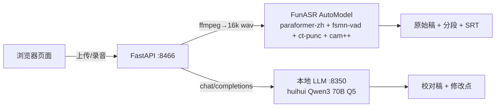

# 语音转写工作台 · ASR-Web

FunASR Paraformer 中文语音转写 + LLM 校验的轻量 Web 工作台。上传/录音 → 转写（带说话人分离、词级时间戳）→ LLM 校对（同音字纠错、ASR 幻觉清除、语气词清理）→ 导出 TXT/SRT。

单卡部署（RTX 4090 实测 +1.75GB 显存），16 秒音频转写 1.8 秒（~9× 实时）。

## 功能

- **输入**：文件上传（mp3/m4a/wav/flac/webm/ogg，ffmpeg 静态解码）+ 浏览器录音（MediaRecorder）+ 热词（人名/专名提升识别率）
- **转写**：长音频自动 VAD 分段；说话人分离（CAM++ 聚类）；词级时间戳；一键导出 TXT / SRT 字幕
- **校验**：
  - 忠实校对——只修 ASR 错误（同音字/错别字/幻觉套话/标点），不改写原意
  - 整理润色——去语气词、口语顺滑、书面化
  - 修改点列表（原→改+原因）+ 字符级 Diff 视图
- LLM 无外网依赖：直连本地 OpenAI 兼容推理服务（Strata Control / vLLM / llama.cpp server 均可）

## 架构



## 快速部署

### 1. 环境

```bash
python3 -m venv /data/tools/funasr-env
/data/tools/funasr-env/bin/pip install torch torchaudio numpy==1.26.4 \
    funasr modelscope fastapi "uvicorn[standard]" python-multipart imageio-ffmpeg
```

> imageio-ffmpeg 自带静态 ffmpeg 二进制，服务器无需 `apt install ffmpeg`。

### 2. 模型下载（魔搭直连）

```bash
pip install -U modelscope
modelscope download --model iic/speech_seaco_paraformer_large_asr_nat-zh-cn-16k-common-vocab8404-pytorch --local_dir /data/models/funasr/paraformer-zh
modelscope download --model iic/speech_fsmn_vad_zh-cn-16k-common-pytorch     --local_dir /data/models/funasr/fsmn-vad
modelscope download --model iic/punc_ct-transformer_zh-cn-common-vocab272727-pytorch --local_dir /data/models/funasr/ct-punc-zh
modelscope download --model iic/speech_campplus_sv_zh-cn_16k-common          --local_dir /data/models/funasr/cam++
```

### 3. 配置

```bash
cp asr.env.example asr.env   # 填入你的 LLM 地址 / key / 模型 id
chmod 600 asr.env
```

### 4. 启动

```bash
# 手动跑
set -a; source asr.env; set +a
CUDA_VISIBLE_DEVICES=2 uvicorn app:app --host 0.0.0.0 --port 8466

# 或 systemd（参考 mm-asr-web.service）
cp mm-asr-web.service ~/.config/systemd/user/
systemctl --user daemon-reload && systemctl --user enable --now mm-asr-web
ufw allow 8466/tcp
```

## API

| 端点 | 说明 |
|---|---|
| `GET /api/health` | 模型加载/ffmpeg 状态 |
| `POST /api/transcribe` | multipart `file` + `hotword?` → `{text, segments[], srt, duration_sec, elapsed_sec}` |
| `POST /api/verify` | `{text, mode: faithful\|clean, cleanup_filler}` → `{corrected, changes[], elapsed_sec}` |

## 配置项

| 环境变量 | 说明 |
|---|---|
| `LLM_BASE_URL` | OpenAI 兼容端点，默认 `http://127.0.0.1:8350/v1` |
| `LLM_API_KEY` | LLM 鉴权 key |
| `LLM_MODEL` | 校验用模型 id |
| `ASR_MODEL_DIR` | 模型根目录（下含 paraformer-zh/fsmn-vad/ct-punc-zh/cam++ 四个子目录） |

## 已知坑

- **Thinking 模型必须关推理**：Qwen3 系（huihui 等）不关会烧光 `max_tokens` 且 `content` 为空，需在请求里带 `"chat_template_kwargs": {"enable_thinking": false}`。
- `[hidden]` 元素若带 `display:flex` 类会被覆盖常显，页面已加 `[hidden]{display:none!important}`。
- ct-punc 选 zh 版（272727 vocab）即可，比 cn-en large 小一半；cam++ 魔搭 id 是 `speech_campplus_sv_zh-cn_16k-common`（`svz` 拼法的仓库不存在）。

## License

MIT
